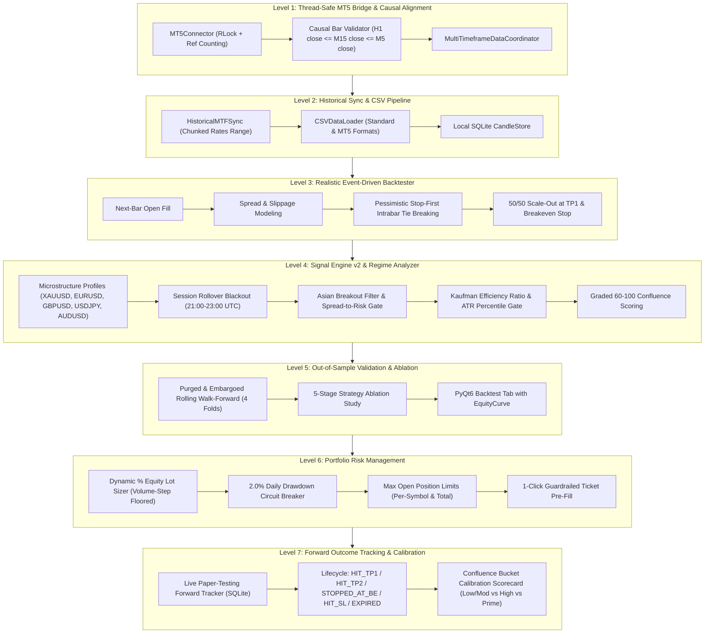

# NeuroTrade AI

[](https://www.python.org/downloads/)
[](https://www.microsoft.com/windows)
[](https://riverbankcomputing.com/software/pyqt/)
[](https://www.mql5.com/)
[]()

**NeuroTrade AI** is a local quantitative algorithmic trading research workstation and manual demo execution engine built in Python 3.12 and PyQt6 for Windows 11. Designed specifically for intraday XAUUSD (Gold) and major FX pairs, the platform combines causal multi-timeframe analysis (H1/M15/M5), event-driven realistic backtesting, purged rolling walk-forward validation, dynamic mathematical risk management, and live forward-testing outcome calibration.

---

## Safety, Compliance & Realistic Trading Principles

> [!IMPORTANT]
> **Strict Safety Constraints Enforced by Code:**
> 1. **DEMO ACCOUNTS ONLY**: The system programmatically checks account type on every connection and order creation. Real-money accounts are permanently blocked.
> 2. **NO AUTONOMOUS EXECUTION**: Signals never place orders automatically. All trades require explicit manual review, verification, and confirmation by the human operator.
> 3. **PROBABILISTIC HONESTY**: Signal confidence scores ($60.0 - 100.0$) represent heuristic rule-confluence tallies, **not** mathematical win probabilities.

---

## 7-Level Quantitative Architecture



### Level 1 — Thread-Safe MT5 Bridge & Causal Alignment
- **Concurrency & Reference Counting**: `MT5Connector` uses re-entrant threading locks (`threading.RLock`) and active session counters so background workers (chart timers, data synchronizers, signal generators) do not prematurely terminate shared MT5 sessions.
- **Smart Terminal Discovery**: Automatically detects running MT5 processes across custom directories before falling back to registry/environment paths.
- **Causal Bar Ordering**: Strict validation prevents lookahead leakage:
  $$\text{time}_{\text{H1, close}} \le \text{time}_{\text{M15, close}} \le \text{time}_{\text{M5, close}}$$
  Excludes unclosed forming bars and warns on stale higher-timeframe data.

### Level 2 — Historical Data Pipeline & CSV Loader
- **`HistoricalMTFSync`**: Chunks date-range downloads via `copy_rates_range()` into 30-day batches, normalizing timestamps to UTC epoch in `CandleStore`.
- **`CSVDataLoader`**: Imports external datasets, automatically distinguishing standard comma-separated and MetaTrader tab-delimited formats (`<DATE>`, `<TIME>`, `<OPEN>`, `<HIGH>`, `<LOW>`, `<CLOSE>`, `<TICKVOL>`, `<SPREAD>`). Validates monotonicity and price integrity ($H \ge \max(O,C), L \le \min(O,C)$).

### Level 3 — Realistic Event-Driven Intraday Backtester
- **Zero-Lookahead Execution**: Order fills occur strictly at bar $i+1$ open price plus half-spread and slippage (never at bar $i$ close).
- **Pessimistic Intrabar Resolution**: If a single candle touches both stop loss and take profit, the stop loss is guaranteed to trigger first.
- **50/50 Partial Scale-Out**: Closes 50% volume at Take Profit 1 ($+1.5R$), simultaneously trailing the stop loss on the remaining 50% to breakeven ($0.0R$) while targeting Take Profit 2 ($+2.0R$).
- **Institutional Scorecard**: Tracks Sharpe ratio, Sortino ratio, max drawdown %, recovery factor, win rate, and expectancy ($R$).

### Level 4 — High-Precision Signal Engine v2 & Regime Filter
- **Microstructure Profiles**: Built-in parameters for 5 major instruments:
  - Gold (`XAUUSD`), Euro (`EURUSD`), British Pound (`GBPUSD`), Japanese Yen (`USDJPY`), Australian Dollar (`AUDUSD`).
- **Institutional Execution Filters**:
  1. *Rollover Blackout*: Blocks new orders between 21:00 and 23:00 UTC (illiquid settlement window).
  2. *Asian Breakout Filter*: Restricts premature breakout entries during quiet consolidation (00:00–07:00 UTC).
  3. *Spread-to-Risk Gate*: Rejects setups if $\frac{\text{Spread}}{\text{Risk Distance}} > \text{Threshold}$ (default $10\%–15\%$).
  4. *Kaufman Efficiency Ratio (KER)*: Suppresses false breakouts during choppy/whipsaw markets.
  5. *ATR Expansion Gate*: Confirms entry only when volatility is expanding relative to recent history.
- **Graded Confluence Score ($60.0 - 100.0$)**: Multi-factor heuristic score combining directional trend agreement, momentum alignment, and structural support/resistance.

### Level 5 — Purged Walk-Forward Validator & Filter Ablation
- **Purged & Embargoed Rolling Walk-Forward**: Evaluates out-of-sample stability across contiguous folds ($k=4$) with an explicit embargo gap (48 M5 bars) between folds to eliminate serial correlation.
- **5-Stage Strategy Ablation Study**: Sequentially isolates filter performance on identical data:
  1. `1_Baseline_v1`: Baseline H1/M15/M5 indicator alignment.
  2. `2_Plus_Session_Rollover`: Baseline + Rollover blackout + Asian breakout exclusion.
  3. `3_Plus_Spread_Gate`: Stage 2 + Spread-to-risk limit gate.
  4. `4_Full_v2_Regime_Gate`: Stage 3 + Kaufman efficiency ratio & ATR expansion gates.
  5. `5_Full_v2_ScaleOut_TP1_BE`: Full v2 suite + 50/50 scale-out at TP1 with Breakeven stop.
- **PyQt6 Backtest Panel**: Dedicated GUI tab with interactive parameter configuration, live execution logs, and Matplotlib equity curves with drawdown shading.

### Level 6 — Portfolio Risk Management & Guardrailed Pre-fill
- **Mathematical Lot Sizing**:
  $$\text{Risk Dollars} = \text{Equity} \times \left(\frac{\text{Risk } \%}{100}\right)$$
  $$\text{Raw Lots} = \frac{\text{Risk Dollars}}{\text{Stop Ticks} \times \text{Tick Value}}$$
  $$\text{Lot Size} = \max\left(\text{Vol}_{\min}, \min\left(\text{Vol}_{\max}, \left\lfloor\frac{\text{Raw Lots}}{\text{Step}}\right\rfloor \times \text{Step}\right)\right)$$
  *Strictly floors lot size to broker `volume_step` so risk is never rounded up.*
- **2.0% Daily Loss Circuit Breaker**: Blocks trading if current equity represents a loss $\ge 2.0\%$ from starting daily equity.
- **Position Exposure Limits**: Enforces maximum positions per symbol (default 1) and account total (default 2).
- **1-Click Pre-fill**: The Signals tab includes a `Pre-fill in Trading Panel` action that calculates SL/TP point offsets and pre-fills the manual trading ticket without submitting orders.

### Level 7 — Live Forward Tracker & Confluence Calibration
- **Paper-Trading Lifecycle**: Tracks recorded live signals against forward M5 candles stored in SQLite, categorizing outcomes:
  - `HIT_TP1 (+1.5R)`
  - `HIT_TP2 (+2.0R)`
  - `STOPPED_AT_BE (0.0R)`
  - `HIT_SL (-1.0R)`
  - `EXPIRED` (holding limit reached)
- **Empirical Calibration Scorecard**: Groups resolved setups into heuristic score tiers to verify empirical edge monotonicity:
  - **Low/Moderate Confluence** ($60.0 - 74.9$)
  - **High Confluence** ($75.0 - 84.9$)
  - **Prime Confluence** ($85.0 - 100.0$)

---

## Installation & Setup

### Requirements
- **OS:** Windows 11 (64-bit)
- **Python:** 3.12 (64-bit recommended)
- **Terminal:** MetaTrader 5 (Demo account logged in)

### Step-by-Step Setup

1. **Clone the repository:**
   ```powershell
   git clone https://github.com/Ameersuhail799/NeuroTrade.git
   cd NeuroTrade
   ```

2. **Create and activate a Python 3.12 virtual environment:**
   ```powershell
   py -3.12 -m venv .venv
   .\.venv\Scripts\Activate.ps1
   ```

3. **Install pinned dependencies:**
   ```powershell
   pip install -r requirements.txt
   ```

4. **Verify Windows Smart App Control compatibility:**
   ```powershell
   Get-ChildItem -Path .\.venv -Recurse | Unblock-File -ErrorAction SilentlyContinue
   .\.venv\Scripts\python.exe -c "import pandas, numpy, PyQt6; print('Environment OK:', pandas.__version__, numpy.__version__)"
   ```

---

## Verification & Unit Testing

Run the full comprehensive test suite (all 58 unit tests across 8 test suites):
```powershell
.\.venv\Scripts\python.exe -m unittest discover -s tests -v
```

Verify clean bytecode compilation:
```powershell
.\.venv\Scripts\python.exe -m compileall -q core gui tests backtest_terminal.py
```

---

## CLI Backtester Usage

`backtest_terminal.py` allows offline quantitative testing without launching the GUI.

### 1. Generate Synthetic Sample Data
```powershell
.\.venv\Scripts\python.exe scripts/generate_sample_csvs.py
```

### 2. Run 5-Stage Filter Ablation Study
```powershell
.\.venv\Scripts\python.exe backtest_terminal.py --symbol XAUUSD `
  --h1-csv data/samples/synthetic_xauusd_1H.csv `
  --m15-csv data/samples/synthetic_xauusd_15m.csv `
  --m5-csv data/samples/synthetic_xauusd_5m.csv `
  --ablation
```

### 3. Run Purged Rolling Walk-Forward Validation
```powershell
.\.venv\Scripts\python.exe backtest_terminal.py --symbol XAUUSD `
  --h1-csv data/samples/synthetic_xauusd_1H.csv `
  --m15-csv data/samples/synthetic_xauusd_15m.csv `
  --m5-csv data/samples/synthetic_xauusd_5m.csv `
  --walk-forward
```

### 4. Standard Intraday Backtest from SQLite
```powershell
.\.venv\Scripts\python.exe backtest_terminal.py --symbol XAUUSD --source sqlite --bars 5000 --risk 0.01
```

---

## GUI Desktop Application Usage

Launch the full interactive PyQt6 workstation:
```powershell
.\.venv\Scripts\python.exe neurotrade.py
```

### Application Tabs:
- **Chart Viewer:** Live candlestick chart viewer with MT5 feed and indicator overlays.
- **Data Engine:** Multi-timeframe historical synchronization (`1H`, `15m`, `5m`) and CSV import/export.
- **Trading Panel:** Guardrailed manual demo trading with real-time margin/equity metrics and positions table.
- **Signals Panel:** Real-time multi-timeframe signal generation, 1-click order ticket pre-fill, and live forward outcome tracking with calibration report.
- **Backtest Panel:** Full backtesting studio supporting historical runs, 5-stage filter ablation, and purged walk-forward validation with dynamic equity charts.
- **Feedback & Performance:** Adaptive weighting adjustment and institutional trade performance analytics.

---

## License

Personal and educational research use only.
Not intended for commercial redistribution or unmonitored financial execution.
